# Valenced Theme Keys

A plain guide to theming Discord with [Valenced](https://github.com/Valenced/valenced), and a list of
which colour key paints what. Documented examples are checked in an Android emulator with screenshots.

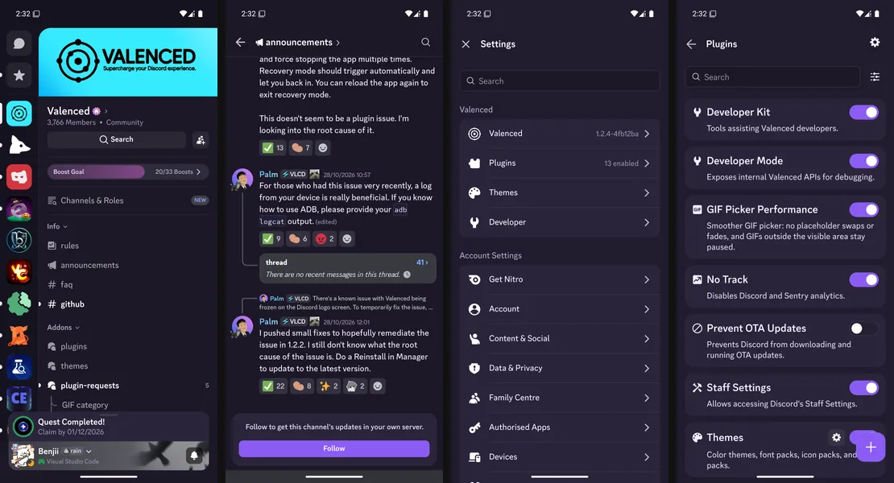

*That's [the starter theme](public/template/) in this repo. It changes 25 colours.*

- **[KEYS.md](KEYS.md)**: the tested keys, grouped by area, each with a picture of exactly what it colours.
- **[ALL-KEYS.md](ALL-KEYS.md)**: every key Discord has, with its default on each base.
- **[template/](public/template/)**: a starter theme you can copy, as JSON or as a plugin.

The site at [themes.benjiisworld.com](https://themes.benjiisworld.com) has the same keys with search, a
**theme studio** (an interactive Valenced phone you can recolour, inspect, save and export), short docs, and a
converter from old Vendetta/Bunny theme JSON to a Valenced plugin. It reads the same data files, so it never
goes out of date.

## Working on the site

It's a Next.js static export. `npm install`, then `npm run dev`, or `npm run build` to write `out/`.
Pushing to `main` deploys it to GitHub Pages through [.github/workflows/pages.yml](.github/workflows/pages.yml)
(set Pages to deploy from GitHub Actions in the repo settings).

| Path | What |
| --- | --- |
| `app/`, `components/` | Pages: keys, studio, docs, converter, templates |
| `content/docs/` | The docs pages, in markdown |
| `studio/engine/` | The studio's editor and phone preview (plain JS, mounted by `components/studio/`) |
| `data/`, `public/images/` | Key data and screenshots, written by `tools/` |
| `tools/` | Scripts that refresh the keys from an emulator |

## How colours work

Discord gives everything on screen a named colour, and a theme swaps those colours out. There are two kinds:

**Semantic keys** describe a job, like `TEXT_DEFAULT` or `CHANNEL_BACKGROUND_DEFAULT`. You set them
per base (see below), so a dark theme and a light theme can differ. Start with these, since they're easy
to aim.

**Raw keys** are the palette underneath, like `NEUTRAL_69` or `BLURPLE_50`. Most semantic keys just point
at one of them. Changing a raw key changes everything that uses it, on every base. That's handy for big
sweeps, like recolouring Discord's blurple everywhere with one line, but hard to aim.

If you set both, the semantic key wins for that spot.

Discord has four **bases**, the themes you pick in Discord's own Appearance settings. Your theme can
cover any of them; ones you leave out keep Discord's colours.

| In Discord | In a theme |
| --- | --- |
| Ash | `dark` |
| Dark | `darker` |
| Light | `light` |
| Onyx | `midnight` |

Colours are hex: `#RRGGBB`, or `#RRGGBBAA` to add transparency.

## Start here

These twelve cover most of what you see. Pink is what each one paints.

| | | | |
| :-: | :-: | :-: | :-: |
| 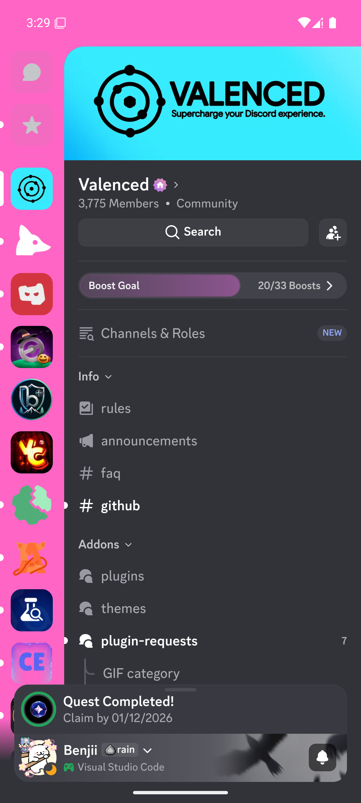<br>`BACKGROUND_BASE_LOWEST`<br>server rail | 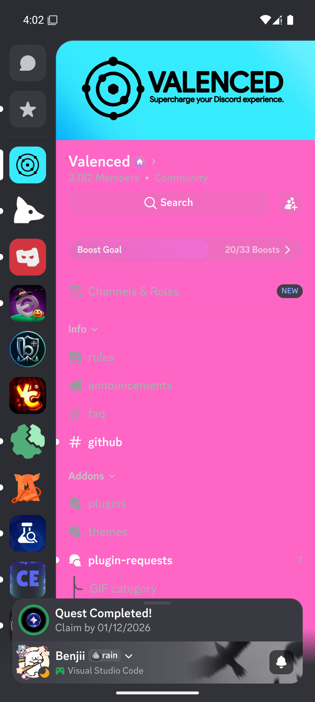<br>`PANEL_BG`<br>DM and channel list | 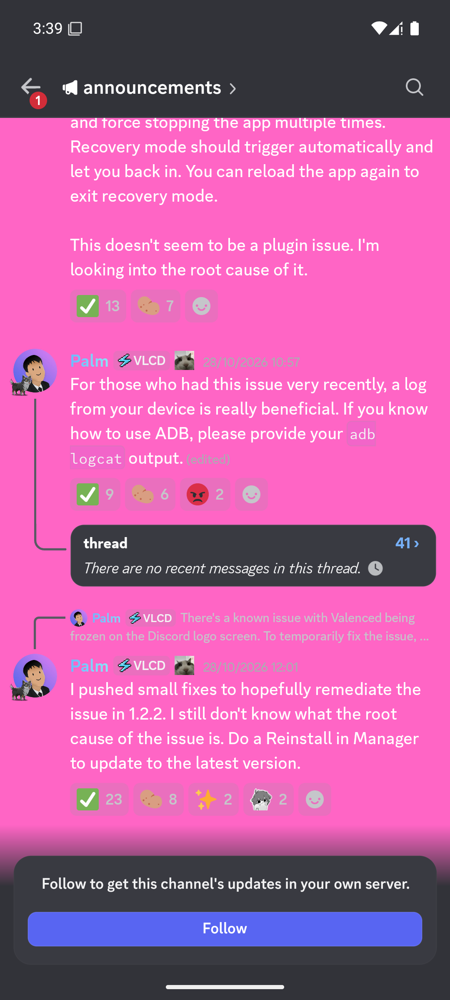<br>`CHANNEL_BACKGROUND_DEFAULT`<br>chat | 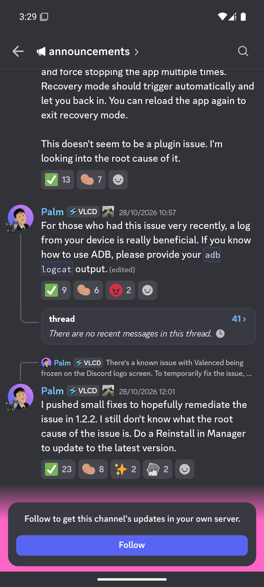<br>`BACKGROUND_BASE_LOWER`<br>under the chat box |
| 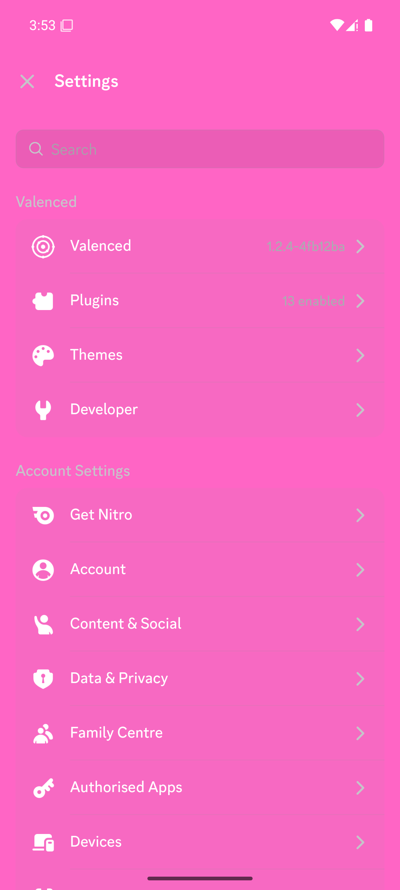<br>`MOBILE_ACTIONSHEET_BACKGROUND`<br>settings pages | 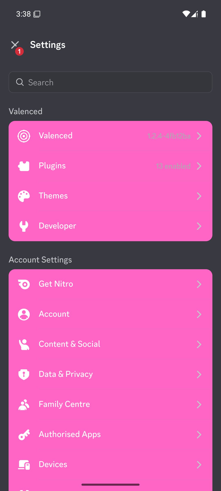<br>`CARD_MUTED_BG`<br>settings rows | 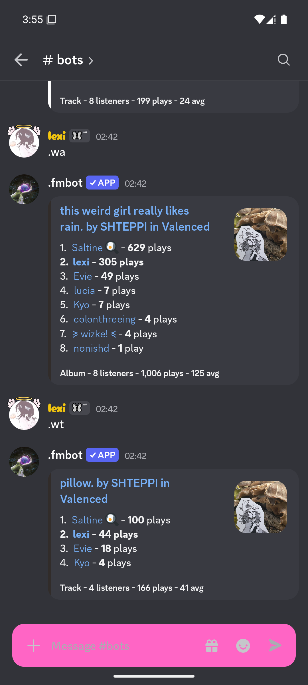<br>`MOBILE_CHATINPUT_BACKGROUND_DEFAULT`<br>chat box | 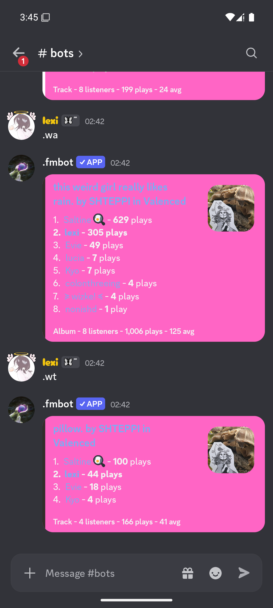<br>`EMBED_BACKGROUND`<br>embeds |
| 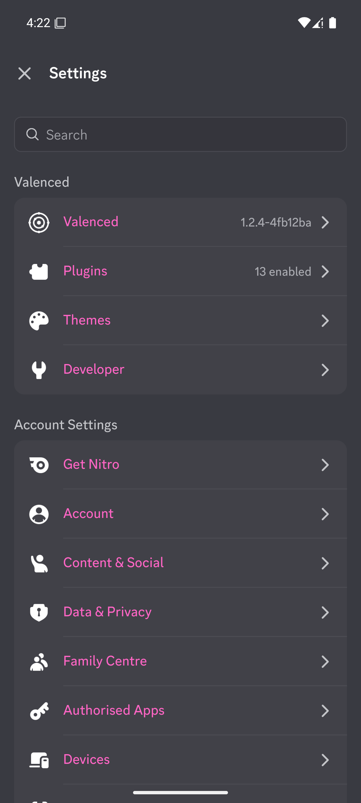<br>`TEXT_STRONG`<br>main text | 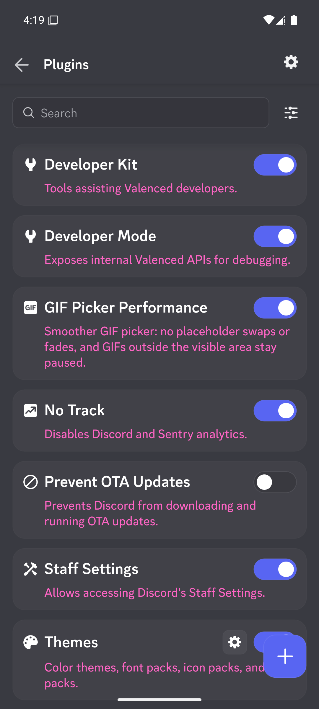<br>`TEXT_DEFAULT`<br>descriptions | 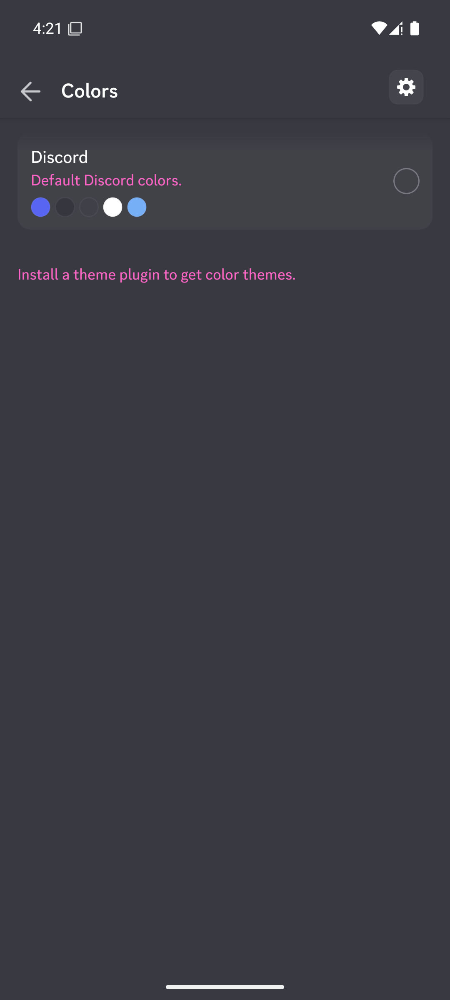<br>`TEXT_MUTED`<br>timestamps, hints | 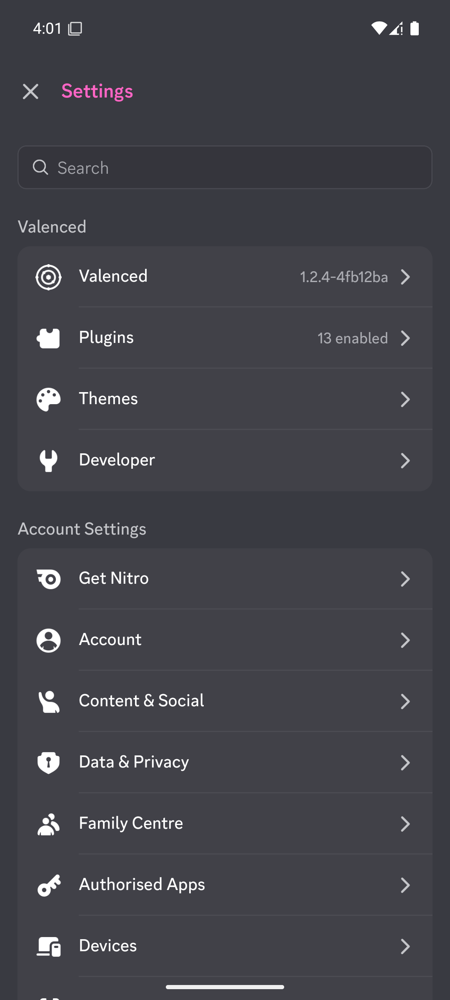<br>`MOBILE_TEXT_HEADING_PRIMARY`<br>page titles |

For the brand colour (buttons, switches, the selected rail button), set the raw key `BLURPLE_50`.

## Making a theme

### Without code: a JSON file

Valenced's **Legacy Themes** plugin imports themes in the old Vendetta/Bunny format by URL.

1. Copy [template/legacy-theme.json](public/template/legacy-theme.json) and change the colours.
2. Upload it somewhere that serves the raw file, like a GitHub repo or Gist. Use the **raw** link.
3. In Discord, open **Settings > Themes > Manage theme plugins** and install **Legacy Themes**.
4. In its settings, paste the link under **Theme or font pack URL** and tap **Import theme**.
5. Pick it under **Themes > Colors**.

Each semantic key takes a list: `["ash and dark", "light", "onyx"]`. Leave out the ones you don't need.
Onyx falls back to the first colour, and Light is left alone if you skip it.

```json
"semanticColors": {
	"CHANNEL_BACKGROUND_DEFAULT": ["#1c1827", "#f4f0ff"]
}
```

### With code: a theme plugin

Plugins can do more: separate colours for Ash and Dark, colours worked out from Discord's own palette,
backgrounds, fonts, icons and emoji.

1. Get the [Valenced plugin template](https://github.com/Valenced/valenced-plugin-template) and follow its setup.
2. Copy [template/plugin](public/template/plugin) into its `themes/` folder. Change the ID in `manifest.json`.
3. Edit the colours in `js/index.ts`.
4. Build with `./gradlew packageAllPlugins`. The ZIP lands in `build/dist/`.
5. In Discord, open **Settings > Plugins**, tap the gear, then **Install from file**, and pick the ZIP.

The [Themes API docs](https://github.com/Valenced/valenced-website/blob/main/content/docs/plugin-development/api-reference/themes.mdx) cover the rest.

## Tips

- **Keep overlays see-through.** Some keys are meant to be translucent, like `BACKGROUND_SCRIM` (the dim
  behind menus) and the `BACKGROUND_MOD_*` pills. A solid colour there covers what's underneath, so add
  alpha: `#00000099`. [ALL-KEYS.md](ALL-KEYS.md) shows which defaults have alpha.
- **Some places only update after a reload.** Discord caches a few styles. The Themes screen offers a
  reload button after you pick a theme.
- **Profile themes are left alone.** People's Nitro profile colours always show as they set them.
- **Backgrounds** make surfaces see-through, and use `BACKGROUND_BASE_LOWER` as the tint over the image.
- **An exported key is not a confirmed example.** The full catalogue includes keys that have not appeared
  in the screens and states tested here. Absence from a screenshot does not prove a key is unused.

## How the keys were tested

The full exported semantic and raw catalogues are first given distinct probe colours and checked across
Discord screens and controlled previews of Discord's own components. These previews cover states such
as pressed buttons, selected controls, validation errors, badges and notifications without changing
account data.

Visible matches are then checked individually: only one key is changed to pink through the Themes API,
and a full-resolution screenshot is captured after the interface updates. Related views appear together under the key on the site.
An outline helps locate smaller targets. Translucent raw colours are compared against an unchanged screenshot,
inside an already verified target region; their pink tint can be faint. Personal text is scrambled in the emulator before capture; the interface stays sharp.

Screenshots verify Discord 352.6 Alpha with Valenced Android 1.2.4 on Ash. The other bases have exported
defaults, but have not been visually verified. See [data/tested.json](data/tested.json) for recorded observations.

## Keeping it up to date

Discord renames and adds keys now and then. The scripts in [tools/](tools/) read the colour tables from
Discord with Valenced on an Android emulator, recapture the pink screenshots and regenerate the data and
docs. If you use Claude Code, the `update-theme-keys` skill in this repo walks through it: open Claude Code
here and ask it to update the theme keys. To do it by hand:

```sh
cd tools && npm install
adb -s emulator-5554 reverse tcp:7684 tcp:7684
node bridge.js            # leave running; turn on DevTools auto-connect in Valenced's Developer settings, restart Discord
node dump.js              # data/tokens.json and data/resolved.json; lists added, removed and renamed keys
node capture.js home      # the screen open on the emulator; repeat for each screen in data/tested.json
node build-docs.js        # data/keys.json, KEYS.md and ALL-KEYS.md
```

`node update.js --all-screens` runs these in order and asks you to open each screen. Capture adds to the
data for that screen and keeps every other screen's observations. Options such as `--keys`, `--tested` and
`--dry-run` are listed at the top of each script. Screens named `component-*` came from component previews
that are not in this repo.

Then fill in anything `build-docs.js` reports as needing a description, in
[data/descriptions.json](data/descriptions.json), and run `node tools/build-docs.js` again.

## Theme studio

The site's **Theme studio** page is a visual editor built on the same data as the key reference.

Every key card links to it with **Edit in the studio** (`/studio/#KEY`, raw keys `/studio/#@KEY`). The
current theme autosaves in the browser; **My themes** keeps a list of saved themes you can open, duplicate,
rename, export and delete (Ctrl+S saves). On narrow screens the studio uses Keys, Edit and Preview panels.

- **Preview.** A browser recreation of Valenced on Android: the server rail, Messages, a server's channel list,
  announcement and text channels, DMs and group DMs, forums, member search, notifications, profiles, Settings,
  Plugins, theme colours, the message menu, alerts, the server menu, the emoji picker and Discord's shared
  controls. Rows, channels, reactions, switches, tabs and the chat box work. Long-press or right-click messages
  and server icons for their menus. Data is made up and stays in the browser.
- **Editing.** Pick any semantic or raw key, per base (Ash, Dark, Light, Onyx). Dark and Onyx can follow Ash.
  Colours accept HEX, RGB and HSL and are stored as `#RRGGBB` or `#RRGGBBAA`. Undo and redo, autosave in the
  browser, and a source view for the legacy JSON or plugin `index.ts` with live validation.
- **Inspector.** Turn on Inspect (I) and click anything in the phone to see which keys paint it, whether that was
  verified on that screen, and what it sits on. Avatars, server art and role colours are marked as fixed.
  Selecting a key outlines everything it paints, and lists other screens that use it.
- **Import and export.** Legacy theme JSON, a theme plugin's `index.ts`, or ThemeColors JSON. Exports follow
  Valenced's own parser: legacy `semanticColors` are `[dark, light, midnight]`, and Dark always shares Ash.
  Unknown keys and extra fields (such as `background`) are kept and flagged rather than dropped.

Limitations:

- The preview places each colour from the key data; keys without a documented example are marked
  **Unverified** in the inspector, since their real target is inferred from the name.
- Fonts fall back to the system font when gg sans is not installed, so text runs slightly wider than on a phone.
- Pressed states only show while you hold a control; hover, ripple and scroll effects are simplified.
- Profile themes, backgrounds from themes, font, icon and emoji packs are not previewed.
- The Light, Dark and Onyx defaults come from Discord's exported tokens; only Ash was checked against screenshots.
- Plugin `index.ts` import reads literal colour strings. Values computed at runtime (such as `discord.raw.X`)
  are reported and skipped.

## Credits

The idea and layout come from [Purple-EyeZ/Bunny-Theme-Keys](https://github.com/Purple-EyeZ/Bunny-Theme-Keys),
which did this for Bunny.

## Repairing older themes

After importing a theme with keys absent from the current table, a banner shows **Repair all**. One click migrates all supported legacy keys, preserving their colours across bases, with one Undo step for the entire batch. Existing destination conflicts, conflicting legacy sources, invalid colours, and keys without known replacements are retained and listed for manual attention. The banner also appears for previously saved themes. Batch mappings are pinned to [theme-fixer map.json](https://github.com/blancodagoat/theme-fixer/blob/32a3f861955e216bf0eec88079a677cea27d68a8/map.json), a community Discord 345.0 reference; destinations are checked against this site's current table. These mappings approximate intent where Discord split or changed tokens, so review the preview after repair.

For manual corrections, open **Theme studio > Repair** (or **Review repairs** under Needs attention). Select an imported semantic or raw key, compare historical bindings with the captured current build, choose a current destination, and correct the saved hex colours. Apply moves the overrides; conflicting destination colours require explicit replacement. Undo restores the complete previous theme. Metadata and unrelated keys are preserved. Export the repaired theme using the normal export menu.

Historical data comes from [nexpid/Themelings](https://github.com/nexpid/Themelings/tree/data), pinned in `studio/engine/token-history.json` to Discord Android 268.1 alpha (`37e2273db4653cf6b51d6fd9d20ca85b57fc58e8`), 298.3 alpha (`c4789949273935a8d99315efd0e9d3f6c8169b1c`) and 341.1 alpha (`335c886ba5e2ae626191ddbb29f6c5d2f985e1ea`). The history loads locally on demand; imported themes are not sent to GitHub. These are reference snapshots, not a complete history or an automatic version detector. Equal raw bindings and opacity provide candidates, not verified renames. Current destinations must exist in this site's captured token table. Raw consumer lists show changes in which semantic keys use a colour.

Repair handles colour values and token names after a successful import; malformed JSON syntax still needs correcting before import. Preview and review the result: a matching token binding does not establish identical UI usage across Discord versions.
